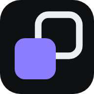
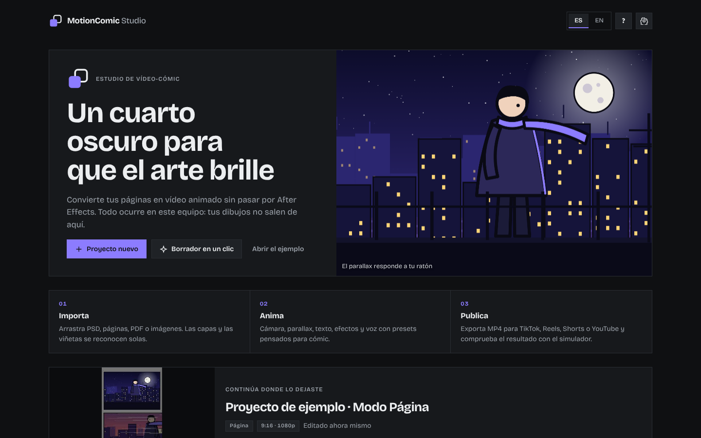
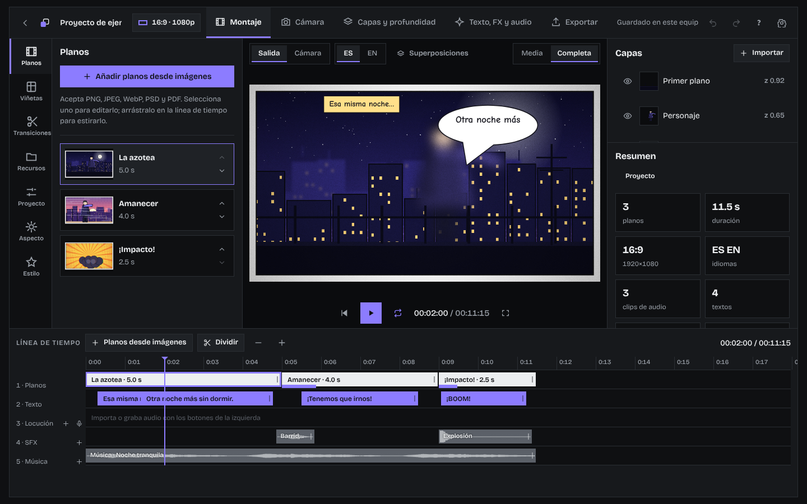
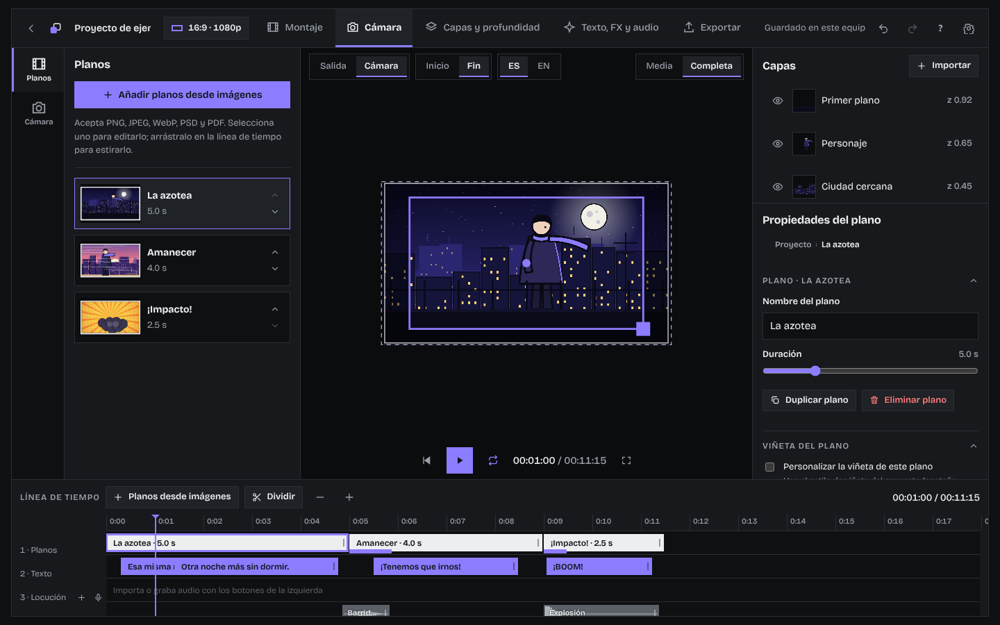
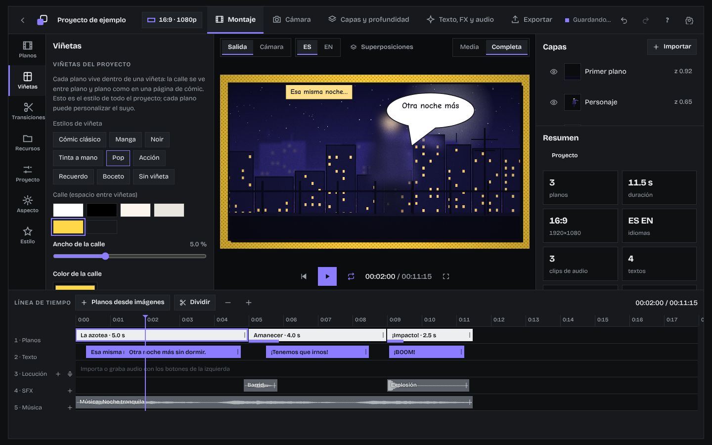
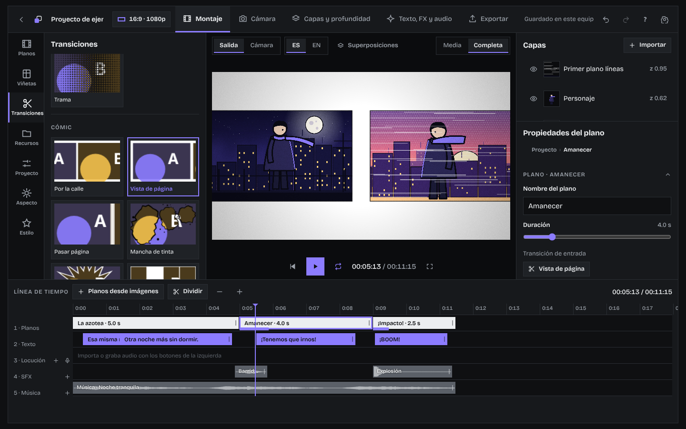
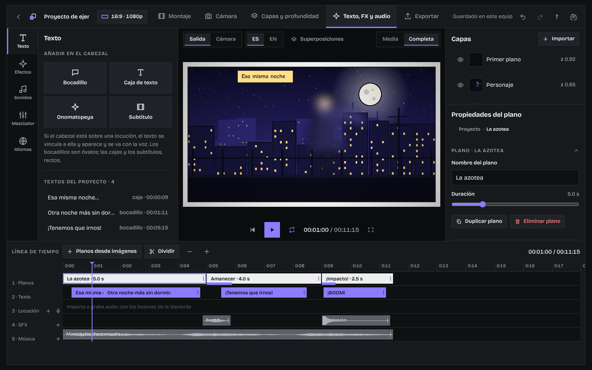
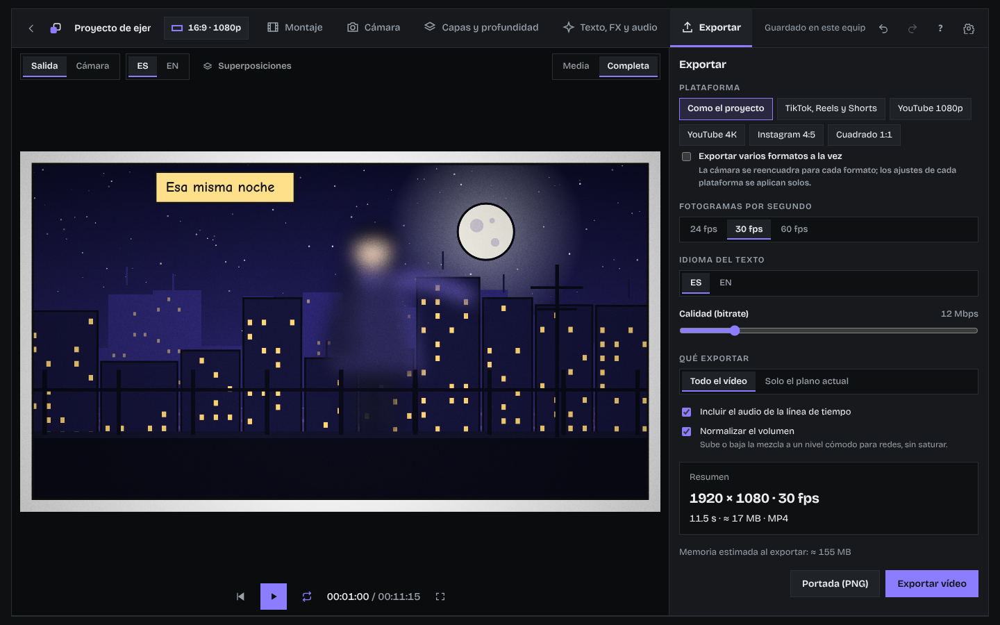

<p align="center">
  
</p>

<h1 align="center">MotionComic Studio</h1>

<p align="center">
  <b>Un estudio instalable para convertir tus ilustraciones de cómic en vídeo animado.</b><br>
  Coloca tus dibujos, dales profundidad, mueve la cámara, añade bocadillos, sonido y transiciones, y exporta un MP4 listo para redes.<br>
  Todo funciona en tu navegador y se guarda en tu equipo: sin cuentas, sin servidores y sin subir tus dibujos a ningún sitio.
</p>

<p align="center">
  <a href="https://github.com/LuckStudio/motioncomic-studio">Repositorio en GitHub</a> ·
  <a href="#instalación">Instalación</a> ·
  <a href="#primeros-pasos">Primeros pasos</a> ·
  <a href="#conexión-con-una-ia-mcp">Conexión con IA</a>
</p>

<p align="center">
  
</p>

---

## Índice

- [Qué es](#qué-es)
- [Para quién es](#para-quién-es)
- [Instalación](#instalación)
- [Primeros pasos](#primeros-pasos)
- [Tres formas de trabajar](#tres-formas-de-trabajar)
- [El estudio por dentro](#el-estudio-por-dentro)
- [Funciones en detalle](#funciones-en-detalle)
- [Archivos que acepta y que genera](#archivos-que-acepta-y-que-genera)
- [Atajos de teclado](#atajos-de-teclado)
- [Conexión con una IA (MCP)](#conexión-con-una-ia-mcp)
- [Privacidad y datos](#privacidad-y-datos)
- [Requisitos y límites](#requisitos-y-límites)
- [Publicarlo en tu propia web](#publicarlo-en-tu-propia-web)
- [Para desarrolladores](#para-desarrolladores)
- [Créditos](#créditos)

---

## Qué es

MotionComic Studio es una aplicación web **instalable** (PWA) para hacer **vídeo-cómic**: animaciones sencillas a partir de ilustraciones fijas. Está pensada para que un ilustrador llegue de sus páginas o capas a un vídeo con movimiento sin pasar por un programa de edición de vídeo profesional.

La idea es simple:

1. **Colocas tus ilustraciones**: capas sueltas, un PSD, páginas completas, un PDF o una tira vertical.
2. **Les das vida**: parallax 2.5D entre capas, movimientos de cámara, viñetas con borde de cómic, transiciones, bocadillos, efectos y sonido.
3. **Exportas un MP4** con el formato de la red donde lo vayas a publicar (TikTok, Reels, Shorts, YouTube, Instagram…).

Lo que ves en el visor es exactamente lo que se exporta: el visor y el exportador usan el mismo motor de dibujo.

## Para quién es

- **Ilustradores y dibujantes de cómic** que quieren mover sus páginas en redes sociales.
- **Autores de webtoon** que necesitan un tráiler o un avance en vídeo vertical.
- **Narradores y creadores de contenido** que quieren poner voz a una historia ilustrada.
- Cualquiera que quiera hacer **animaciones sencillas** con imágenes fijas sin aprender software de animación.

No hace falta saber de vídeo: hay presets para casi todo, un borrador automático en un clic y tutoriales dentro del propio estudio.

---

## Instalación

MotionComic Studio se abre como una página web y se puede **instalar como una app**. Una vez instalada, abre en su propia ventana, aparece junto a tus otras aplicaciones y **funciona sin conexión**.

| Dispositivo | Cómo instalarla |
|---|---|
| **Ordenador con Chrome o Edge** | Pulsa el icono de instalar en la barra de direcciones, o el botón **Instalar** de la pantalla de inicio. |
| **Android (Chrome)** | Menú ⋮ → **Instalar aplicación** o **Añadir a pantalla de inicio**. |
| **iPhone y iPad (Safari)** | Botón **Compartir** → **Añadir a pantalla de inicio**. |
| **Mac (Safari 17 o posterior)** | Menú **Archivo** → **Añadir al Dock**. |

Dentro de la app, **Preferencias → Instalación** detecta tu dispositivo y te explica los pasos exactos.

Cuando hay una versión nueva, la app la descarga sola y te avisa en la pantalla de inicio para que actualices cuando quieras.

---

## Primeros pasos

1. **Abre el ejemplo.** La primera vez ya hay dos proyectos de ejemplo cargados (uno libre y uno de página completa) para que veas cómo está montado todo.
2. **Crea un proyecto.** En el inicio, pulsa **Proyecto nuevo**, elige el modo (Libre, Página completa o Webtoon), el formato (9:16, 16:9, 4:5, 1:1…) y la resolución.
3. **O pide un borrador.** **Borrador en un clic** te deja subir páginas o imágenes y monta solo un primer vídeo: detecta viñetas, fija el orden de lectura y coloca cámara, duraciones y transiciones. Luego lo retocas todo.
4. **Arrastra tus archivos** al visor o usa **Importar**.
5. **Dale al play**, ajusta, y cuando te guste ve a **Exportar**.

Tienes tutoriales guiados sobre el propio estudio en el botón **?** (importar, parallax, voz, exportar, rack focus, curvas, fotogramas clave, viñetas, Mi estilo, superposiciones y texto) y un icono **?** junto a cada pestaña y sección que explica para qué sirve.

<p align="center">
  
</p>

---

## Tres formas de trabajar

### Modo Libre: plano a plano, con capas

Cada **plano** es una escena hecha de capas (fondo, edificios, personaje, primer plano…). Las capas se colocan a distintas **profundidades** y, al mover la cámara, las cercanas se mueven más que las lejanas: es el efecto **parallax 2.5D**. Cada plano vive dentro de una **viñeta** con su borde y su calle, como en una página de cómic.

Ideal cuando tienes tus ilustraciones separadas por capas o un PSD.

### Modo Página completa: la cámara recorre tus viñetas

Subes páginas de cómic terminadas y la herramienta **detecta las viñetas sola** (sin IA, analizando los espacios blancos entre ellas). La cámara pasa de viñeta en viñeta en orden de lectura occidental o manga, con paneo suave o salto, y atenúa el resto de la página para centrar la atención.

Las viñetas detectadas se pueden corregir: moverlas, cambiar sus esquinas, dibujar viñetas nuevas (también con forma de polígono libre), reordenarlas o quitarlas. Una viñeta puede convertirse en un plano libre para animarla por capas.

### Modo Webtoon: scroll vertical

Subes una tira vertical larga (o varias imágenes, que se apilan en una) y la cámara baja por ella con la velocidad que elijas, **se para** en los momentos clave y hace **zoom** sobre los detalles. «Sugerir pausas» propone una por cada bloque de la tira.

---

## El estudio por dentro

El estudio se organiza en **tres espacios de trabajo**, cada uno con lo que necesitas para una tarea:

| Espacio | Para qué sirve |
|---|---|
| **Montaje** | Planos o páginas, viñetas, cámara, curvas, rack focus (cambios de foco entre capas), recursos, biblioteca, proyecto (formato y resumen), aspecto general, estilo y favoritos. |
| **Efectos y audio** | Texto y bocadillos, subtítulos, efectos, transiciones, sonidos, música, mezclador e idiomas. |
| **Exportar** | Plataforma, calidad e idioma, y salida a MP4, WebM, GIF, PNG, audio, portada o subtítulos. |

Los paneles se pueden mover, redimensionar, ocultar o sacar a otra ventana, y la disposición se guarda con nombre (**vistas guardadas**).

En la columna derecha, **Capas** y **Propiedades** muestran solo lo que corresponde a lo que tengas seleccionado (proyecto, plano, capa, texto, clip de audio, efecto, viñeta o pausa). Esc quita la selección.

---

## Funciones en detalle

### Parallax y cámara

- **Profundidad por capa** con valores rápidos (cielo, fondo, lejos, medio, personaje, primer plano) o ajuste fino. El nombre de la capa ya da una pista: «cielo», «fondo», «personaje», «primer plano»…
- **Tres intensidades de parallax** (sutil, normal, intensa).
- **Movimientos de cámara listos**: quieta, zoom in, zoom out, paneos en las cuatro direcciones, Ken Burns, temblor y ángulo holandés, con intensidad y curva de suavizado.
- **Encuadre manual** del fotograma inicial y final, y **trayectorias dibujadas** con varios puntos, cada uno con su zoom, su pausa y su tiempo de viaje.
- **Sin huecos**: el fondo se agranda solo para que la cámara nunca enseñe los bordes de la imagen, y una superposición marca en rojo los huecos si los hubiera.
- **Calculadora de resolución**: te dice qué tamaño de imagen necesitas para el formato y el zoom que quieres.

<p align="center">
  
</p>

### Viñetas con borde de cómic

Cada plano del modo libre tiene su **contenedor de viñeta**, que se configura para todo el proyecto o plano a plano:

- **Calle**: el espacio entre viñetas, con su ancho y su color (blanco, negro, papel, cualquier color) y una textura opcional: trama de puntos, papel, rayado o líneas de acción.
- **Forma**: recta, inclinada, romboide, trapecio, girada, estallido, recuerdo (borde ondulado) u óvalo.
- **Trazo que la bordea**: línea, tinta a mano, boceto, doble, discontinua o sin trazo, con grosor y color.
- **Sombra** con su color.
- **Estilos listos**: cómic clásico, manga, noir, tinta a mano, pop, acción, recuerdo, boceto y sin viñeta.
- **Ilustraciones que rompen la viñeta**: cualquier capa puede ir **por encima del borde** y dibujarse sobre el trazo y la calle, como un personaje que se sale del recuadro.

En el modo Página, tus páginas ya traen sus viñetas; se puede añadir un marco alrededor del encuadre y un contorno a la viñeta activa.

<p align="center">
  
</p>

### Transiciones

**28 transiciones** en cuatro familias, cada una con duración, curva (suave, lineal, frena, acelera, rebote, seco) y, según el tipo, dirección, color y distancia:

| Familia | Transiciones |
|---|---|
| **Básicas** | Corte, fundido a negro, fundido a blanco, encadenado, destello |
| **Movimiento** | Barrido, empujar, cubrir, descubrir, latigazo, zoom a través, giro |
| **Formas** | Círculo, iris de dibujos, rombo, reloj, persianas, puertas, trama |
| **Cómic** | Por la calle, vista de página, pasar página, mancha de tinta, estallido, mosaico de viñetas, pop, impacto, interferencia |

**Por la calle** y **Vista de página** ponen las dos viñetas una al lado de la otra, separadas por la calle blanca o negra, y la cámara viaja de una a otra como si leyeras el papel. El catálogo muestra miniaturas animadas de cada transición, y tienes «Ver la transición» y «Aplicar a todos».

<p align="center">
  
</p>

### Superposiciones y vídeo

Además de las capas de cada plano, puedes poner elementos **fijos por encima de toda la ilustración**, en sus propias pistas de la línea de tiempo (hasta 6) y fuera del movimiento de la cámara:

- **Imágenes y vídeos** (MP4, WebM, MOV): un personaje ya animado con la boca en movimiento, un marco, un logotipo, un overlay de partículas…
- **Croma**: si el vídeo está grabado sobre verde o azul, se quita el fondo (con tolerancia, suavizado y limpieza del reflejo). Si ya tiene transparencia (WebM con alfa), se respeta.
- Colocar y escalar arrastrando en el visor (esquina para el tamaño, círculo para girar), rejilla de posiciones, voltear, opacidad, modos de mezcla, bloquear.
- El **audio del vídeo** pasa a la pista de locución y sigue al clip cuando lo mueves o lo recortas.
- Los vídeos también pueden ser **capas dentro de un plano**, con parallax y profundidad.
- Si varios clips de una misma pista se **solapan**, pasan a una segunda fila dentro de esa pista para verlos bien.

> Para trabajar con vídeo y archivos pesados, MotionComic Studio funciona mejor **instalado en tu ordenador o tableta**.

### Capas como en Photoshop y Procreate

- **Arriba = más cerca**: la capa de arriba tapa a las de abajo, y el orden coincide con la profundidad (z). Arrastra una capa para reordenarla y su profundidad se ajusta sola; si cambias la profundidad, la capa sube o baja en la lista.
- Por capa: **ojo, candado, renombrar** (doble clic), **duplicar** (Ctrl+J), **eliminar**, **modo de mezcla** (12 modos) y **opacidad**, además de llevar adelante o atrás, al frente o al fondo.
- **Importar**: desde el equipo, **de las imágenes del proyecto o de la biblioteca** (selector con miniaturas), una capa de color liso, o carpetas y ZIP.
- **Arrastrar y soltar** imágenes o vídeos —desde Recursos, la biblioteca, el selector o el explorador de archivos— al panel de capas, en el punto exacto de la pila.

### Línea de tiempo con arrastrar y soltar

- Suelta un recurso en el **hueco de la pista de planos** y crea un plano nuevo; suéltalo **sobre un plano** y se añade como capa. En una pista de superposición o de audio, lo coloca ahí.
- **Planos desplegables**: la flecha de cada plano muestra su pila de capas, reordenables arrastrando; suelta un recurso en una altura concreta para colocarlo arriba o como fondo.
- **Planos superpuestos**: pistas de planos que se ven **a la vez** que el principal, con su propia cámara, capas y efectos (las zonas vacías son transparentes). Se pueden pasar de la pista principal a la superpuesta y al revés.

### 3D

- **Giro en X e Y con perspectiva** en cada capa y superposición (además del giro en Z), con poses rápidas y perspectiva ajustable. Se anima con fotogramas clave.
- **Entradas y salidas 3D** (volteos, giros desde un lado, puerta, voltereta, vuelo) y bucles 3D (tarjeta que se mece, cabeceo, giro completo, bamboleo).
- **Transiciones 3D** entre planos: cubo, volteo de carta, puerta, voltereta y carrusel, con dirección.
- **Vista de profundidad en 3D**: las capas como planos en el espacio, con la cámara y su pirámide de visión; gira la escena con el ratón (frontal, 45°, lado, arriba) y arrastra una capa para moverla en profundidad.

### Animación de capas

- **Entradas, salidas y bucles** por capa y por superposición: aparecer, deslizarse, pop, zoom, caída con rebote, giro, flotar, balanceo, respirar, latido…
- **Fotogramas clave** visibles como rombos en la línea de tiempo (mover, escalar, girar y desvanecer), con **editor de curvas Bézier**. La curva de la cámara también es editable.
- **Pivote** por capa (por ejemplo, el hombro de un brazo) y **límite de desplazamiento** del parallax.
- **Personaje por capas**: capas de «ojos cerrados» que parpadean solas y capas de **boca que se abren según el volumen de la locución**.
- **Aspecto por elemento**: sombra, resplandor, contorno de pegatina y ajuste de color (brillo, contraste, saturación, tono).

### Texto del cómic

- **Bocadillos** de habla, grito y pensamiento con cola arrastrable, **cajas de texto**, **onomatopeyas** y **subtítulos**.
- **Revelado** de golpe, por palabras o por letras, y **entradas animadas** (pop, rebote, golpe, deslizar).
- **Sincronía con la voz**: un texto vinculado a un clip de locución aparece cuando suena su frase.
- **Subtítulos desde la locución**: uno por frase con su tiempo (el texto lo escribes tú; no hay reconocimiento de voz). Se queman en el vídeo o se exportan como SRT.
- **Varios idiomas** en el mismo proyecto, y exportación de cada versión por separado.
- **Tipografías**: cuatro incluidas y la posibilidad de subir las tuyas (TTF/OTF).

<p align="center">
  
</p>

### Subtítulos palabra a palabra

Un espacio propio, la pestaña **Subtítulos** de «Texto, FX y audio»:

- **Una capa por locución**: guarda todo el texto y el momento exacto de cada palabra. En la línea de tiempo es una sola capa que se subdivide en **líneas** que ves dentro de ella (y tantas capas como quieras).
- **Marcar palabra a palabra**: reproduce la voz o mueve el cursor y, cuando se dice la palabra marcada, pulsa **Fijar** (Intro). Pasa sola a la siguiente. Si hay un silencio, pulsa **Silencio** (o el punto) en ese momento. Retroceso deshace. También puedes fijar cada tiempo a mano, ajustarlo con ± y forzar una línea nueva desde una palabra.
- **Repartir por igual** o **ajustar a las pausas de la voz** para tener un punto de partida.
- **Importar un archivo de tiempos**: JSON de Whisper, Deepgram o ElevenLabs, listas de `{palabra, inicio, fin}`, SRT, VTT o CSV. Los huecos entre palabras se convierten en silencios.
- **Seguimiento de palabra**: la palabra que suena se resalta (color, tamaño, fondo), con otros modos: una palabra cada vez o que el texto vaya apareciendo.
- **31 estilos listos** en cuatro familias (Redes, Cine y serie, Cómic, Creativos), con vista previa animada al pasar el cursor, y **16 tipografías nuevas** incluidas. Controles de tipografía, tamaño, colores, trazo, sombra suave y dura, degradado, fondo (color, opacidad, margen, borde y **radio**), alineación, espaciado, inclinación, animación, posición rápida, ancho y letras por línea, y efectos de la palabra que suena (salto, rebote, subrayado, brillo).
- Exportación a **SRT** y subtítulos quemados en el vídeo.

### Efectos y aspecto

- **Animación dentro de la viñeta**: temblor, golpe de impacto con destello (y sonido si quieres), pulso y vibración. Se aplican al plano entero, a una capa o a una viñeta concreta.
- **Efectos de acción y ambiente**: líneas de velocidad y de concentración, aberración cromática, destello de color, lluvia, polvo, chispas, nieve y humo.
- **Rack focus**: el enfoque pasa de una capa a otra.
- **Niebla** y **haces de luz** como efectos de ambiente, y **dolly zoom** (efecto vértigo) como movimiento de cámara.
- **Aspecto general**: saturación, contraste, brillo, temperatura, viñeteado, grano de película, tramado de cómic (halftone) y tinte de color.
- **Vista previa al pasar el cursor** sobre los movimientos de cámara y los efectos.

### Audio

- Tres pistas: **locución**, **efectos (SFX)** y **música**.
- Importa WAV, MP3, M4A u OGG, o **graba con el micrófono** con cuenta atrás.
- Mover, recortar y dividir clips, volumen y fundidos por clip, mezcla por pista y **ducking automático** (la música baja sola cuando habla la voz).
- **Marcadores en las pausas de la voz** y «ajustar planos a la voz» para que cada plano dure lo que su frase.
- **Mezclador** con silenciar, solo y medidores de nivel por pista.
- **Marcadores con notas** (M) y **marcadores de pulso musical** (B); detección automática del pulso de la música y «cortes al pulso».
- **Biblioteca de 66 sonidos generados por código**, por categorías (impactos, movimiento, cómic, ambiente, tecnología y magia, terror) y 12 músicas, con búsqueda, vista previa y arrastre a la línea de tiempo. Sin archivos ni licencias.

### Exportación

- **MP4** codificado en el propio navegador: H.264 (o VP9 si no hay H.264) con audio AAC u Opus.
- **WebM** (VP9 + Opus), **GIF animado** (hasta 480 px y 30 s), **secuencia de PNG** en un ZIP y **solo audio** (WAV).
- **Presets por plataforma**: TikTok, Reels y Shorts (9:16), YouTube 1080p y 4K, Instagram 4:5 y cuadrado.
- Fotogramas por segundo, calidad, rango (todo o solo el plano actual), idioma del texto y normalización del volumen.
- **Varios formatos a la vez**: por ejemplo 16:9 y 9:16 en una pasada; en páginas y tiras la cámara se recalcula para cada formato.
- **Portada en PNG** y **subtítulos SRT**.
- **En segundo plano**: puedes seguir editando mientras exporta; la barra superior te avisa al terminar.
- **Simulador de plataformas**: una interfaz genérica de app de vídeo vertical sobre el visor para ver qué tapan los botones, y **zonas seguras**.

<p align="center">
  
</p>

### Línea de tiempo avanzada

- **Selección múltiple** (Mayús o Ctrl + clic, o recuadro con Mayús + arrastrar), mover varios clips a la vez, **duplicar** (Ctrl+D), **agrupar** y desagrupar.
- **Ripple**: al cambiar la duración de un plano, todo lo que va detrás lo acompaña.
- **Pista de efectos** con los efectos de todos los planos, **miniaturas** dentro de los clips de plano y **tira de fotogramas** en los de vídeo.
- Pista de **fotogramas clave** del elemento seleccionado.

### Tus proyectos: archivo, versiones y biblioteca

- **Guardar una copia en un archivo** `.motioncomic` (un ZIP con el proyecto y todos sus medios) y abrirla en otro equipo.
- **Historial de versiones**: se guarda solo cada pocos minutos y al cerrar; también versiones con nombre y «Restaurar».
- **Biblioteca** compartida entre proyectos, con carpetas y etiquetas: personajes, fondos, efectos de sonido… para usar como capa, superposición o audio.
- Avisa si queda poco espacio en el navegador.

### Espacios de trabajo y línea de tiempo al estilo CapCut

- **Tres espacios**: **Montaje** (planos, viñetas, cámara, curvas, capas y profundidad, recursos, biblioteca, proyecto, aspecto y estilo), **Efectos y audio** (texto, subtítulos, efectos, **transiciones**, **efectos de sonido**, **música**, mezclador e idiomas) y **Exportar**.
- **Barra de iconos de la línea de tiempo**: deshacer y rehacer, selección (V) y **cuchilla** (X, corta donde pulsas), dividir (S), **recortar principio (Q) y final (W)** hasta el cabezal, eliminar, **reflejar** en horizontal y vertical, **recortar** la imagen o el vídeo, **fotograma clave**, editor de curvas, marcador, duplicar, **imán** (N, se pega a cortes, marcadores y cabezal), ripple, añadir planos o superposiciones, y **zoom** con deslizador, botones, Ctrl + rueda y «ajustar todo». Muchas actúan sobre lo seleccionado (audio, texto, superposición, capa o plano).
- **Imán de verdad**: al arrastrar o estirar cualquier clip (audio, texto, superposición, plano superpuesto, duración del plano), tanto su **inicio como su final** se pegan a los bordes de los demás clips, a los cortes de plano, a los marcadores y al cabezal cuando están cerca, y aparece una **línea guía amarilla** donde va a encajar. Mantén **Alt** mientras arrastras para soltar sin imán, o apágalo con el icono del imán (N).
- **Capas con tiempo propio**: despliega un plano con la flechita y cada capa es una fila que puedes **mover**, y estirar por la izquierda o la derecha para decidir **cuándo aparece y cuándo desaparece**, con imán. El inspector de la capa tiene la sección **Tiempo y gestos**.
- **Gestos con varias ilustraciones en la misma capa**: con la capa seleccionada, **Dividir** (S) la parte en tramos en el cabezal; a cada tramo le pones **otra ilustración** (botón Reemplazar, o arrastrando una imagen sobre el tramo) y la capa conserva su posición, escala, animación y fotogramas clave. Hay **fundido opcional** entre gestos y se pueden quitar los cortes cuando quieras. Q y W recortan dónde aparece y desaparece la capa.
- **Eliminar planos** con la tecla Supr o el botón del plano, con Ctrl+Z para recuperarlo.
- **Fotogramas clave en todo**: posición X e Y, escala, **ancho y alto** por separado, giro, opacidad y giro 3D, en capas, superposiciones y **textos**. Salen como rombos sobre el elemento en la línea de tiempo y se arrastran.
- **Editor de curvas** (pestaña «Curvas», que además puedes sacar a otra pantalla): gráfica por propiedad, rombos que se arrastran en tiempo y valor, y **tiradores Bézier** para suavizar o endurecer cada tramo, como en After Effects.
- **Favoritos** ★ en sonidos, transiciones y estilos de subtítulos, con filtro propio y una pestaña «Favoritos».

### Interfaz ajustable

- **Arrastra los bordes** del panel izquierdo, de la columna derecha y de la línea de tiempo para cambiar su tamaño; **doble clic** en un borde para ocultarlo.
- **Paneles acoplables, como en Premiere o Photoshop**: cada panel (Visor, Línea de tiempo, Herramientas, Capas y Propiedades) tiene un menú ⋮ para **moverlo a la izquierda o a la derecha** (la línea de tiempo, arriba o abajo) u ocultarlo, y un asa ⠿ para **arrastrarlo** a un lado. Hay disposiciones listas (Estándar, Todo a la izquierda, Todo a la derecha, Línea de tiempo arriba, Solo visor y línea) en el menú de Vista; se recuerdan en tu equipo.
- **Varias ventanas y varias pantallas**: «Sacar a otra ventana» (o arrastrar el asa ⠿ fuera de la ventana) abre el panel en una ventana propia, por ejemplo el **visor en un segundo monitor** y el resto del estudio en el primero. Funciona con los mismos atajos, edición y reproducción; si cierras la ventana el panel vuelve solo. Con «Sacar a otra pantalla…» eliges el monitor (Chrome y Edge piden permiso de gestión de ventanas) y «Reabrir las ventanas de la última vez» las recupera. Requiere permitir las ventanas emergentes.
- **Modo táctil** (automático en tablets y pantallas táctiles; se puede forzar o quitar en Preferencias › Apariencia): botones de 44 px como mínimo, tiradores de los paneles con zona de toque de 30 px, bordes de los clips más anchos, flecha de capas, rombos de fotograma clave y deslizadores más fáciles de agarrar, y todo lo que antes solo aparecía al pasar el ratón (estrellas de favoritos, controles ⋮ y ⠿) siempre visible.
- **Pulsación larga**: sobre cualquier icono muestra su **nombre y su atajo**; sobre las vistas previas de cámara, efectos y estilos de subtítulos, las reproduce mientras mantienes el dedo. El Apple Pencil usa el hover igual que el ratón.
- **Menú contextual**: clic derecho (o pulsación larga en táctil) sobre un plano, una capa, un clip de audio, un texto, una superposición, un fotograma clave o una pista abre sus acciones: dividir, duplicar, eliminar, reflejar, recortar, fotograma clave, reemplazar ilustración, renombrar y bloquear. Sustituye a los dobles clics (renombrar capas y pistas, crear fotogramas clave), que además siguen funcionando.
- **Gestos con dos dedos**: pellizcar acerca o aleja la línea de tiempo y el visor, y arrastrar con dos dedos los desplaza. Con un dedo sobre el fondo vacío de la línea de tiempo también se desplaza.
- **Precisión**: el botón de la cruz de la barra de la línea de tiempo (o mantener Mayús durante el arrastre) hace que rombos, bordes y clips se muevan a un cuarto de velocidad, útil con el dedo o el lápiz.
- **Deshacer sin teclado**: al eliminar un plano, una capa o un clip sale un aviso con un botón **Deshacer**.
- **Teclado y lectores de pantalla**: el visor se puede enfocar (**Tab** pasa de capa en capa, las **flechas** mueven la capa, superposición o texto seleccionados, con **Mayús** más, y **+** y **−** cambian su tamaño). En la línea de tiempo, al llegar con Tab, las flechas pasan de un clip al de al lado, arriba o abajo; **Alt + Mayús + flechas** recortan el final (← →) y el principio (↑ ↓), con Ctrl en pasos de 1 s. **F6** (o **Alt + 1 … 5**) salta entre Visor, Línea de tiempo, Herramientas, Capas y Propiedades. Hay títulos y regiones con nombre, un `h1` y enlaces «Saltar a…» al principio.
- **Hoja de atajos** con **?**: muestra los atajos del espacio de trabajo en el que estás y los generales, con un botón para personalizarlos.
- **Temas**: según el sistema, oscuro, claro, **gris medio**, **azul noche**, **sepia** y uno **personalizado** donde eliges la base (oscura o clara), tu **color de acento** y, si quieres, el color de fondo; avisa si el acento apenas se distingue del fondo. Se cambian en Preferencias › Apariencia y se recuerdan.
- **Alto contraste** (negro y blanco puros con acento amarillo en oscuro, o azul intenso en claro, bordes marcados y foco grueso) y **selección con símbolo**: lo seleccionado se marca con un borde y un ✓, no solo con color (se puede desactivar).
- **Escala automática en tablet**: la primera vez que se abre en una tablet, la interfaz sube sola al 115 % (130 % en pantallas pequeñas) y avisa de cómo cambiarlo.
- **Personalizar la interfaz** (Preferencias › Interfaz, o «Personalizar la interfaz…» en el menú Vista): elige qué **herramientas de la línea de tiempo** (imán, cuchilla, reflejar, curvas…), qué **pestañas** (Biblioteca, Rack focus, Favoritos…) y qué **espacios de trabajo** quieres ver. Por defecto se ve todo; lo que ocultes sigue funcionando con su atajo y se recupera con «Mostrar todo».
- **Vistas guardadas**: guarda con nombre tu disposición de paneles, lo que tienes oculto, el tema y el tamaño (por ejemplo «Tablet» o «Dos pantallas»), aplícala cuando quieras y **expórtala a un archivo `.mcview`** para tener copia o llevarla a otro equipo; también se pueden importar.
- **Avisos de versión nueva**: cuando se publica una versión más reciente, sale una tarjeta «Hay una versión nueva del estudio» con **Actualizar ahora** (guarda antes tu proyecto y recarga) o **Más tarde** (queda un botón «Actualizar» en la barra superior). Si el navegador se queda con una copia vieja guardada, avisa de que «tu navegador tiene una versión anterior» y te dice qué hacer en tu equipo: **Ctrl + Mayús + R** en Windows y Linux, **Cmd + Mayús + R** en Mac (en Safari, Cmd + Opción + E y luego Cmd + R) o cerrar y volver a abrir la app en iPad y móvil; el botón **Forzar actualización** lo hace por ti (quita las copias guardadas del programa sin tocar tus proyectos). En Preferencias › Acerca de hay un botón «Buscar actualizaciones».
- **Tablet en vertical y pantallas estrechas** (hasta 900 px de ancho): el **visor** queda arriba, la **línea de tiempo** siempre visible debajo y los paneles salen de una **hoja que sube desde abajo** con tres botones (**Panel**, **Capas** y **Propiedades**); se cierra tocando el mismo botón, tocando el asa o arrastrándola hacia abajo. La barra de la línea de tiempo muestra solo lo esencial (deshacer, rehacer, selección, cuchilla, dividir, eliminar, fotograma clave, imán y zoom) y el botón **⋯** abre el resto de herramientas.
- **Propiedades con pestañas, como en CapCut**: al seleccionar algo, el panel de Propiedades tiene una barra de pestañas arriba y enseña una sola sección a la vez. **Plano**: Básico, Cámara, Transición, Viñeta. **Capa**: Básico, Animación (con sus fotogramas clave), Tiempo y gestos, 3D y pivote, Recorte y Aspecto. **Texto**: Texto y Animación. **Audio**: Básico y Volumen y fundidos. **Superposición**: Básico, Animación, 3D, Recorte y Aspecto. Se pasa de una en una con las flechas ‹ ›, con las flechas del teclado o **deslizando el dedo**, y cada tipo recuerda la última pestaña que usaste. Los botones de recortar, dividir y fotograma clave de la línea de tiempo abren solos la pestaña que toca.
- **Fotogramas clave en cada propiedad**: junto a Escala, Posición X e Y, Opacidad, Giro y Tamaño hay un **rombo ◆** (y flechas ◀ ▶ para saltar entre fotogramas). Pulsa el rombo para animar esa propiedad en el instante del cabezal; mueve el cabezal, cambia el valor y se crea otro fotograma solo. El rombo está vacío si no hay animación, con borde si la propiedad tiene fotogramas pero no en este instante, y relleno si hay uno justo aquí. Cada propiedad tiene su propia pista, así que puedes animar la escala sin tocar la posición. En la pestaña **Animación** hay además filas para el ancho, el alto y los giros 3D.
- **Curvas y movimientos listos**: curvas de animación **Lineal, Suave, Acelera, Frena, Rebote, Seco, Elástico, Bote y Mantener**, que se aplican al fotograma seleccionado, a todos los de una propiedad o a todos, y se afinan arrastrando puntos en el editor de curvas. Y **movimientos listos** que crean los fotogramas por ti: zoom lento (acercar y alejar), deriva en cuatro direcciones, latido, entrada pop, entrada desde abajo, entrada con bote, aparecer, desvanecer, temblor, balanceo y giro completo.
- **Visibilidad de las pistas**: cada pista de la línea de tiempo (Texto, Subtítulos, Efectos, Superposiciones, Planos superpuestos, Locución, SFX y Música) tiene en su etiqueta un **ojo** (en el audio, un altavoz) que la quita del vídeo, de la vista previa y de la exportación o la silencia, y una **flecha** que **pliega la fila** de la línea de tiempo para dejar sitio. El botón **Pistas** de la esquina de la regla abre un menú con todas, un contador de las plegadas y «Mostrar todas las pistas». Se guarda con el proyecto, se puede deshacer, y el altavoz comparte estado con el silenciar del mezclador.
- **Paneles junto a la línea de tiempo**: Capas y Propiedades se pueden acoplar **abajo, a la izquierda o a la derecha de la línea de tiempo** (por ejemplo, la línea de tiempo abajo con las capas a su derecha, o al revés). Se mueven con el menú ⋮ del panel («Abajo, a la izquierda/derecha de la línea de tiempo»), arrastrando el asa ⠿ sobre el cuarto izquierdo o derecho de la línea de tiempo, o con las disposiciones listas del menú Vista: «Capas junto a la línea de tiempo (a su derecha)», «Capas a la izquierda de la línea de tiempo» y «Capas y propiedades junto a la línea de tiempo». Cada zona se ensancha arrastrando su borde, y se guarda con las vistas y los archivos `.mcview`.
- **Entrada y salida del estudio con animación**: al abrir un proyecto, la pantalla de inicio se desvanece pieza a pieza (cabecera, bloques y tarjetas, de una en una) y después el estudio se construye en pantalla: primero la barra superior, luego el panel de herramientas, el visor (con un pequeño zoom), las columnas laterales, la línea de tiempo con sus pistas una a una y, por último, los clips dibujándose. Al volver al inicio ocurre al revés (la línea de tiempo baja, los lados salen, el visor se apaga y la barra sube) y el inicio vuelve a entrar poco a poco. Con **animaciones reducidas** (Preferencias o el sistema) no hay animación, y con un **toque o una tecla** se salta al instante.
- **Conexión con IA (opcional, MCP)**: en Preferencias → «Conexión con IA». Un asistente (Claude Desktop, Claude Code u otro cliente MCP) puede abrir el estudio, crear un proyecto, abrirlo y añadir imágenes, vídeos o audio (como recursos o como un plano por archivo). Se usa un conector pequeño sin dependencias (`tools/mcp/server.js`, requiere Node.js 18+) que escucha solo en 127.0.0.1 con un código de emparejamiento; el estudio no se conecta nunca por sí solo, cada cambio pide permiso (con «Permitir todo en esta sesión») y se desconecta en un clic. **Versión IA**: los cambios de la IA sobre un proyecto abierto van a una copia aparte y tu proyecto no se toca; una barra te deja «Ver la mía», revisar los «Cambios», «Aceptar» (tu versión anterior queda en el historial como «Antes de la IA») o «Descartar». Si cierras con la versión IA pendiente, sigue pendiente al volver a abrir. Configuración: `{"mcpServers":{"motioncomic":{"command":"node","args":["/ruta/a/tools/mcp/server.js"]}}}`. Herramientas: `abrir_estudio`, `estado`, `listar_proyectos`, `nuevo_proyecto`, `abrir_proyecto`, `anadir_recursos`, `crear_planos`.
- **Pantalla de carga** al abrir la aplicación (antes del inicio, no al abrir proyectos), con logotipo, versión, mensajes de estado, la **dedicatoria a GotiDraw** y una imagen lateral. La misma tarjeta aparece en **Preferencias → Acerca de** y en **Ayuda → Acerca de**, con el aviso de que está en desarrollo, el enlace al repositorio y un botón para ver la pantalla de carga. Se puede ocultar y cambiar la imagen y el crédito en Preferencias → Apariencia, y hay un botón para verla. Se salta con un toque o una tecla. De serie usa un patrón de viñetas generado al vuelo (imagen provisional hasta tener la definitiva). Se muestra con `?splash=1` también en navegadores automatizados, donde normalmente se omite.
- **Clic derecho en toda la interfaz**: sobre cualquier herramienta de la línea de tiempo, pestaña lateral o espacio de trabajo oculto-able sale **«Ocultar…»** con una ventana de confirmación (y un aviso con «Deshacer»); en el mismo menú puedes **mostrar** lo oculto sin entrar en Preferencias. Clic derecho en la cabecera de un panel abre sus opciones, en el visor ofrece ajustar, pantalla completa, guías y reglas, en la cabecera de una pista ofrece ojo, plegar y gestionar pistas, y en cualquier hueco da acceso a «Personalizar la interfaz» y a la ayuda. En táctil, pulsación larga.
- **Ayuda integrada**: un icono **?** junto al título de cada pestaña y de cada sección de propiedades abre una ventanita con **para qué sirve** y **cómo se usa** (Rack focus, Curvas, Mi estilo, fotogramas clave, superposiciones, giro 3D, pivote…), con un botón para **ver el tutorial** correspondiente. Se cierra con Esc o con un clic fuera. Además de los tutoriales de importar, parallax, voz y exportar hay nuevos de **Rack focus, Curvas, Fotogramas clave, Viñetas, Mi estilo, Superposiciones y Texto**, que cambian solos a la pestaña que explican.
- **Formato y resolución a medida**: el selector de formato (botón de proporción de la barra superior, pestaña Proyecto y «Proyecto nuevo») permite **girar** la proporción entre horizontal y vertical con un botón (4:5 ↔ 5:4, 16:9 ↔ 9:16…), **guardar proporciones propias** (se quedan en este equipo como chips y se pueden quitar), elegir 720p, 1080p, 2K o 4K, un **lado corto personalizado** en píxeles, o **píxeles exactos** (ancho × alto, de 16 a 8192, sin proporción ni resolución). Avisa cuando el tamaño supera un 4K y el MP4 puede fallar, y al exportar vídeo añade 1 px si una medida es impar.
- **Vista previa en plataforma**: en el visor, menú **Superposiciones → «Vista previa en plataforma…»**, una ventana que copia tu vídeo en directo dentro de una simulación de cada app según la proporción: **9:16** TikTok, Reels y YouTube Shorts (móvil con su barra superior, columna de botones, texto y barra inferior); **16:9** YouTube, Twitch (con chat) y Vimeo; **2:1** YouTube y Twitch (con barras negras, como en el reproductor real); **4:5, 3:4 y 1:1** LinkedIn, Instagram y TikTok. Se puede reproducir, ir al inicio y hacer clic en la barra de progreso. Es genérica y aproximada, sin logotipos. El simulador sobre el visor (zonas que tapa la interfaz de TikTok, Reels o Shorts) usa ahora las mismas pantallas.
- **Vista previa antes de aplicar**: al pasar el ratón por encima de una entrada, salida o bucle de una capa, superposición o texto, de una **transición** entre planos, de un **efecto** o de un movimiento de cámara, el visor lo reproduce con tus propios planos y, al salir, todo vuelve a como estaba (no se guarda nada ni se toca el historial). Una etiqueta sobre el visor dice qué estás viendo; el clic lo aplica. También funciona al enfocar con Tab y con pulsación larga en táctil. Si el panel se redibuja, la vista previa se cierra sola.
- **Recorte de capas y superposiciones**: con una capa o superposición seleccionada, pestaña **Recorte** (o la herramienta de recorte de la barra de la línea de tiempo): recuadro con **tiradores en el visor** (cuatro lados y cuatro esquinas), cuatro deslizadores, **valores exactos en %** y un rombo por lado para **animar el recorte con fotogramas clave** (revelar, tapar, abrir). Si un lado está animado, arrastrar su tirador escribe el fotograma clave en el instante actual. Respeta giros, reflejos, parallax y animaciones, y también se exporta. «Quitar recorte» devuelve la imagen entera.
- **Más edición por capa y superposición**: pestaña **Recorte, forma y marco** (recorte, reflejo, **forma** rectángulo, esquinas redondeadas o círculo/elipse, y **marco** de color con grosor propio); en **Aspecto**, además de sombra, resplandor, contorno, brillo, contraste, saturación y tono, ahora **blanco y negro, sepia, invertir colores y desenfoque** por elemento, y los botones **Copiar ajustes / Pegar ajustes** para pasar el aspecto, la forma, el recorte, la mezcla y las animaciones de una capa o superposición a otra. Las capas tienen además **giro** propio (animable). Todo se ve en el visor y en la exportación.
- **Parallax avanzado**: además de la profundidad de cada capa y la intensidad del proyecto, cada capa tiene una pestaña **Parallax** con ajustes rápidos (normal, **fija**, doble, **al revés**, solo horizontal, solo vertical), **desplazamiento horizontal y vertical por separado** (de −2 a 3; negativo = en sentido contrario, 0 = fija), respuesta al **zoom** y al **giro de la cámara**, **empuje extra**, **límite de desplazamiento** y un cálculo de cuánto se mueve con la cámara. El proyecto añade una **curva de profundidad** (marcada, lineal o suave) y cada plano una **profundidad de campo** (pestaña Rack focus): las capas se desenfocan según su distancia a la profundidad enfocada, con zona nítida y desenfoque máximo.
- **Viñetas más personalizables**: en la pestaña Viñetas (proyecto) y en las propiedades del plano (viñeta propia), además de los estilos, la calle, la textura, la forma, el trazo y la sombra, ahora hay **degradados** para la calle (lineal con ángulo o radial) y para el trazo (con segundo color y ángulo), **esquinas redondeadas** en las formas poligonales, **sombra con dirección y desenfoque**, y **Mis estilos de viñeta**: guarda el estilo actual con un nombre en este equipo, aplícalo a otro proyecto o plano y bórralo cuando quieras. Los estilos predefinidos reinician estos ajustes nuevos.
- **Efectos de estilo y personalización a fondo**: siete efectos nuevos de imagen en el grupo «Estilo de imagen» de la pestaña Efectos: **pixelado** (tamaño del píxel), **posterizado** (niveles de color), **duotono** (dos colores), **glitch** (franjas desplazadas, separación de color y cambios por segundo), **cinta VHS** (líneas, ruido, temblor y desborde del color), **contorno de tinta** (sensibilidad, grosor, solo líneas sobre papel blanco) y **trama de puntos**. Todos los efectos (también los de acción y ambiente) tienen «Ajustes avanzados»: velocidad, opacidad, tiempo de entrada y de salida, variación (cambia el azar de las partículas), escala y modo de mezcla. Se ven igual en el visor y en la exportación y funcionan con la vista previa al pasar el ratón.
- **Mi estilo explicado y «Mi guía de estilo»**: la pestaña **Estilo** explica qué guarda «Mi estilo» (cómo montas, no tus dibujos), muestra **qué hay guardado y cuándo**, y **en qué se diferencia el proyecto actual**. En la pantalla de inicio hay una tarjeta **Mi guía de estilo**: una **plantilla editable en Markdown** (cuándo usas cada transición y por qué, ritmo y cámara, parallax, viñetas, texto, efectos, lo que nunca haces) que se guarda sola, se puede **importar y exportar como .md** y **copiar para una IA** junto a los ajustes de «Mi estilo». Una IA conectada por MCP la lee con la herramienta `leer_estilo`; los proyectos nuevos que cree ya aplican tu «Mi estilo».
- **Fotogramas clave desde el visor y «Grabar fotogramas»**: si una capa, superposición o texto ya tiene fotogramas clave, **mover, escalar o girar en el visor crea (o actualiza) un fotograma clave en el cabezal con todos los cambios a la vez** (X e Y juntos), sin tocar el valor base. El botón **Grabar fotogramas** (punto rojo, en la barra del visor) hace lo mismo aunque aún no haya ninguno: crea un fotograma de origen en el segundo 0 y otro en el cabezal. También aplica a la rueda del ratón y a los deslizadores. La preferencia se recuerda.
- **Línea de tiempo más alta**: botones de **filas más altas / más bajas** en la barra (y **Alt + rueda**) cambian la altura de las pistas del 60 % al 260 %, se recuerda, y el panel de la línea de tiempo puede ocupar hasta el 82 % de la ventana.
- **Bases de atajos de otros programas**: en Ayuda → Atajos eliges la base **MotionComic Studio, Premiere, Photoshop, After Effects, Affinity, CapCut, DaVinci Resolve o Blender**; cada una cambia de verdad las teclas del estudio (reproducir, fotograma a fotograma, dividir, cuchilla, imán, fotograma clave, zoom, exportar…) y lo que ese programa no tiene queda «sin atajo». Una **tabla comparativa** muestra qué tecla hace cada cosa en cada programa. Las herramientas (selección, cuchilla, recortar principio y final, imán y **fotograma clave en el cabezal**, `I` por defecto) ya son atajos configurables. Las bases nuevas están escritas **de memoria** con los atajos más habituales de cada programa, sin poder consultarlos en ellos, y la propia pantalla avisa de que conviene revisarlas.
- **Tamaño de la interfaz** del 70 % al 150 % para adaptarla a cada pantalla (menú de la barra superior).
- **Zoom y desplazamiento del visor** (Ctrl + rueda; rueda pulsada o Alt + arrastrar), **reglas** en píxeles y **vista lateral de profundidad** para colocar las capas en el eje Z arrastrándolas.
- **Tabla de traducción** con todos los textos y una columna por idioma.

### Ayudas para trabajar más rápido

- **Borrador en un clic** a partir de páginas o imágenes.
- **Mi estilo**: guarda tus transiciones, viñeta, curva de cámara, ritmo, parallax y tipografías y aplícalos a proyectos nuevos y al borrador. Se exporta e importa como archivo.
- **Presets con nombre** para movimientos de cámara y pilas de efectos, también exportables.
- **Deshacer y rehacer** (hasta 300 pasos por sesión) y **guardado automático**.
- **Guías** de tercios y de margen de título.

### Preferencias y accesibilidad

- Tema **oscuro o claro**, tamaño de la interfaz (100 a 150 %), **animaciones reducidas** e idioma (**español e inglés**).
- **Atajos configurables** con tres bases: MotionComic Studio, Premiere y Photoshop.
- Uso completo con teclado, avisos para lectores de pantalla y objetivos táctiles grandes en tableta.
- **Datos guardados**: cuánto ocupa cada cosa, almacenamiento persistente y borrar todo.
- **Medir mi equipo**: calcula el rendimiento en 1080p y 4K y ajusta los avisos de memoria.

---

## Archivos que acepta y que genera

| Entrada | Detalles |
|---|---|
| **PNG, JPEG, WebP, SVG** | Capas, planos, páginas o partes de una tira. El SVG se convierte a imagen de alta resolución. Avisa si una imagen está en CMYK. |
| **MP4, WebM, MOV** | Vídeo como capa o como superposición, con su audio. Depende de los códecs de tu navegador: MP4 (H.264) y WebM funcionan en Chrome y Edge. |
| **ZIP o carpeta** | Todas las imágenes de una carpeta o un ZIP de golpe (también arrastrando carpetas al visor). |
| **PSD** | En modo libre conserva capas, nombres, grupos, visibilidad, opacidad y modos de fusión básicos, y avisa de capas vacías, ocultas o con nombre repetido. Las **capas de texto** pasan a textos editables. En página y webtoon entra aplanado. |
| **PDF** | Cada página se convierte en imagen a la resolución elegida (hasta 80 páginas). |
| **WAV, MP3, M4A, OGG** | Locución, efectos o música. |
| **TTF, OTF** | Tipografías propias para los textos. |

| Salida | Detalles |
|---|---|
| **MP4 / WebM** | Vídeo H.264 o VP9 con audio AAC u Opus (WebM: VP9 + Opus). |
| **GIF** | Animación corta, hasta 480 px de ancho. |
| **ZIP de PNG** | Un PNG por fotograma. |
| **WAV** | Solo la mezcla de audio. |
| **.motioncomic** | Copia completa del proyecto con sus medios. |
| **PNG** | Portada del vídeo. |
| **SRT** | Subtítulos. |
| **JSON** | «Mi estilo» y presets, para llevarlos a otro equipo. |

---

## Atajos de teclado

Base «MotionComic Studio» (se pueden cambiar todos en **Preferencias → Atajos** o con **Ctrl + /**):

| Acción | Atajo |
|---|---|
| Reproducir o pausar | Espacio |
| Retroceder, pausar, reproducir | J · K · L |
| Un fotograma atrás / adelante | ← / → |
| Un segundo atrás / adelante | Mayús + ← / → |
| Ir al inicio / al final | Inicio / Fin |
| Plano anterior / siguiente | [ / ] |
| Dividir el clip de audio | S |
| Añadir un bocadillo | T |
| Cambiar de vista (cámara, página o tira) | C |
| Pantalla completa del visor | F |
| Acercar / alejar la línea de tiempo | + / − |
| Deshacer / rehacer | Ctrl + Z / Ctrl + Mayús + Z |
| Guardar ahora | Ctrl + S |
| Duplicar lo seleccionado (o la capa) | Ctrl + D (o Ctrl + J) |
| Seleccionar todos los clips | Ctrl + A |
| Marcador con nota / marcar un pulso | M / B |
| Subtítulos: fijar palabra / silencio / atrás | Intro / . / Retroceso |
| Exportar | Ctrl + E |
| Ayuda | ? |

En Mac, Ctrl es ⌘.

---

## Conexión con una IA (MCP)

Opcional y apagada por defecto. Un asistente de IA (Claude Desktop, Claude Code u otro cliente compatible con MCP) puede **abrir el estudio, crear un proyecto y añadir imágenes, vídeos o audio** de tu ordenador.

1. Instala [Node.js](https://nodejs.org) 18 o superior.
2. Descarga la carpeta [`tools/mcp`](tools/mcp) de este repositorio (o usa la que viene en el paquete publicado).
3. Añádela a tu cliente de IA:

```json
{ "mcpServers": { "motioncomic": { "command": "node", "args": ["/ruta/a/tools/mcp/server.js"] } } }
```

4. Pide, por ejemplo: «abre MotionComic Studio y crea un proyecto 9:16 con estas imágenes…». Se abre el estudio emparejado y solo tienes que pulsar **Permitir**.

Cómo se protege: el conector escucha solo en `127.0.0.1` con un código de emparejamiento, el estudio no se conecta nunca por sí solo, cada cambio pide permiso y se desconecta en un clic (**Preferencias → Conexión con IA**). Los cambios que hace la IA sobre un proyecto abierto van a una **versión IA** aparte: tu proyecto no se toca hasta que pulses **Aceptar** (y antes se guarda «Antes de la IA» en el historial). Herramientas disponibles: `abrir_estudio`, `estado`, `leer_estilo`, `listar_proyectos`, `nuevo_proyecto`, `abrir_proyecto`, `anadir_recursos` y `crear_planos`.

---

## Privacidad y datos

- **Tus dibujos no salen de tu equipo.** No hay servidor, cuentas ni analíticas: la importación, la detección de viñetas, el audio y la exportación se hacen en tu navegador.
- Los proyectos y las imágenes se guardan en el **almacenamiento local del navegador** (IndexedDB). En **Preferencias → Datos** ves cuánto ocupa todo y puedes pedir almacenamiento persistente para que el navegador no lo borre.
- Borrar los datos del sitio o desinstalar la app borra también los proyectos. **Exporta tus vídeos** y guarda tus archivos originales.
- Las tipografías van incluidas y la política de seguridad solo permite cargar recursos del propio dominio.

---

## Requisitos y límites

- **Dispositivo recomendado: un ordenador (PC).** Editar vídeo va mucho mejor con más memoria, ratón y teclado. En tablets y móviles se puede mirar y retocar, pero algunas funciones (arrastrar con precisión, ventanas separadas, atajos de teclado, exportaciones pesadas) no funcionan del todo bien; en esos dispositivos el inicio muestra un aviso que se puede ocultar.
- **Navegador recomendado**: Chrome o Edge de escritorio actualizados, que son los más completos.
- **Para exportar** hace falta un navegador con **WebCodecs** (Chrome, Edge y otros basados en Chromium; Safari reciente). Si el tuyo no lo admite, la app te avisa.
- Funciona en **tableta** y **móvil**, con una previsualización de calidad media para ir fluida.
- **Vídeo**: el visor reproduce los vídeos del navegador; para exportar se coloca cada fotograma con exactitud, así que los proyectos con mucho vídeo tardan más. Los códecs que se pueden leer dependen del navegador (MP4/H.264 y WebM en Chrome y Edge).
- **Instalado va mejor**: instalada en el ordenador o la tableta, la aplicación tiene más memoria disponible y el navegador no borra tus proyectos.
- **Memoria**: como referencia, hasta unos 100 megapíxeles de imágenes por proyecto en edición. Las imágenes de más de 4096 px se editan con una copia ligera y se exportan con la original. En 4K con muchos PSD pesados, conviene exportar en 1080p. La app avisa si te acercas al límite de tu equipo.
- **Limitaciones conocidas**: las capas de un PSD entran aplanadas en los modos Página y Webtoon, y los PDF con tipografías asiáticas no incrustadas pueden verse con fuentes de reserva.

---

## Publicarlo en tu propia web

MotionComic Studio es una web estática: basta con subir una carpeta a cualquier hosting con HTTPS.

1. Genera la carpeta de publicación:

   ```bash
   node tools/pack.js
   ```

   Crea `public/` (y `public.zip`) con todos los archivos, el modo sin conexión versionado y las cabeceras de seguridad en `.htaccess`.

   La tarjeta que sale al **compartir el enlace** (WhatsApp, Telegram, X…) apunta a GitHub Pages; si usas tu propio dominio: `SITE_URL=https://tudominio.com node tools/pack.js`.

2. Pruébala en local con las mismas cabeceras:

   ```bash
   node tools/serve.js public
   ```

3. Sube el contenido de `public/` a tu hosting.

La guía completa (HTTPS, cabeceras, caché y actualizaciones) está en [`docs/DEPLOY.md`](docs/DEPLOY.md).

---

## Para desarrolladores

No hay paso de compilación ni dependencias que instalar: es JavaScript, HTML y CSS sin frameworks.

```bash
python3 -m http.server 8000
```

Abre `http://localhost:8000`.

| Ruta | Contenido |
|---|---|
| `index.html` | Punto de entrada. |
| `src/js/render.js` | Motor de dibujo: cámara, parallax, sobreescalado y huecos. El visor y la exportación usan el mismo código. |
| `src/js/panel.js` | Contenedor de viñeta (calle, forma, trazo, sombra) y catálogo de transiciones. |
| `src/js/studio.js` | Interfaz del estudio. |
| `src/js/home.js` | Pantalla de inicio y creación de proyectos. |
| `src/js/overlay.js` | Vídeo importado, croma y pistas de superposición. |
| `src/js/anim.js` | Entradas, salidas, bucles, fotogramas clave, curvas, personaje (parpadeo y boca) y aspecto por elemento. |
| `src/js/outputs.js` | WebM, GIF, secuencia de PNG y solo audio. |
| `src/js/zip.js`, `src/js/file.js` | ZIP, archivo `.motioncomic`, versiones, biblioteca y importación de SVG, ZIP y carpetas. |
| `src/js/page.js` | Detección de viñetas, modo Página y modo Webtoon. |
| `src/js/text.js` | Bocadillos, cajas, onomatopeyas y subtítulos. |
| `src/js/subs.js` | Subtítulos: capas con palabras y silencios, estilos, seguimiento de palabra, importación de tiempos y SRT. |
| `src/js/three.js` | 3D sobre el lienzo: giros con perspectiva mediante mallas de triángulos. |
| `src/js/sounds.js` | Los 66 sonidos y músicas generados por código. |
| `src/js/fx.js` | Efectos, rack focus y aspecto general. |
| `src/js/audio.js` | Pistas, mezcla, grabación y sonidos generados. |
| `src/js/export.js` | Exportación MP4 con WebCodecs, lotes y cola en segundo plano. |
| `src/js/psd.js`, `src/js/pdf.js` | Importación de PSD y PDF. |
| `src/js/db.js` | Guardado local (IndexedDB) y modelo de proyecto. |
| `src/js/sample.js` | Proyectos de ejemplo dibujados por código. |
| `src/js/keys.js`, `help.js`, `helptopics.js`, `prefs.js` | Atajos, ayuda y tutoriales, textos de ayuda del icono «?» por pestaña y sección, preferencias. |
| `src/js/formats.js`, `style.js`, `presets.js` | Formatos y plataformas, «Mi estilo» y presets con nombre. |
| `src/js/touch.js`, `uiconfig.js`, `update.js` | Modo táctil y gestos, interfaz personalizable y vistas guardadas, avisos de versión nueva. |
| `src/js/platforms.js` | Vista previa en plataforma (TikTok, Reels, Shorts, YouTube, Twitch, Vimeo, LinkedIn, Instagram). |
| `src/js/motion.js`, `splash.js` | Animación de entrada y salida del estudio, pantalla de carga. |
| `src/js/mcp.js`, `tools/mcp/server.js` | Conexión con IA: lado del estudio y conector local (Node.js, sin dependencias). |
| `sw.js`, `manifest.webmanifest` | Modo sin conexión e instalación. |
| `tools/` | `pack.js` (publicación), `serve.js` (servidor de prueba), `build.js` (archivo único de previsualización en `dist/`), `share.js` (imagen para compartir el enlace), `icons.js` (iconos PNG). |

Documentación interna:

- [`docs/PRD.md`](docs/PRD.md): brief del producto.
- [`docs/brandbook.html`](docs/brandbook.html): manual de marca.
- [`docs/COBERTURA_PRD.md`](docs/COBERTURA_PRD.md): qué está hecho del brief, sección por sección.
- [`docs/REDISENO_UI.md`](docs/REDISENO_UI.md): plan del rediseño de la interfaz.
- [`docs/HISTORIAL.md`](docs/HISTORIAL.md): historial de desarrollo paso a paso.

### Librerías incluidas (`src/vendor`)

- [mp4-muxer](https://github.com/Vanilagy/mp4-muxer) (MIT): empaqueta el vídeo y el audio en MP4.
- [ag-psd](https://github.com/Agamnentzar/ag-psd) (MIT): lee archivos PSD.
- [pdf.js](https://github.com/mozilla/pdf.js) 3.11.174 (Apache-2.0): convierte páginas de PDF en imágenes.

Las tipografías incluidas tienen licencia SIL Open Font License (OFL).

---

## Alineación automática y alinear / distribuir (0.16)

- **Imán del visor**: al arrastrar una capa, superposición o texto en la vista de salida, su centro y sus bordes se pegan al centro del encuadre, a los bordes, a los tercios, a los márgenes (5 %), a las zonas seguras en vertical y a los bordes y centros de los demás elementos, con una línea guía rosa discontinua. **Alt** lo desactiva mientras arrastras; en el menú *Superposiciones* hay un interruptor «Alineación automática» que se recuerda. Un elemento que ya cubre casi todo el encuadre (un fondo) solo pega su centro, porque sus bordes siempre rondan los del encuadre.
- **Botones de alinear**: en los paneles de capa, superposición y texto (alinear dentro del encuadre) y en la selección múltiple (alinear entre sí): izquierda, centro, derecha, arriba, medio, abajo y, con tres o más elementos, repartir en horizontal y en vertical con huecos iguales. Si el elemento está animado o se está grabando, el cambio crea un fotograma clave.

## Zonas seguras y posiciones de subtítulos (0.17)

- **Zonas seguras por formato**: en vertical (TikTok, Reels, Shorts) se evita la barra de arriba (13 %), el pie con el nombre y la descripción (22 % de abajo) y la columna de botones de la derecha; en horizontal y cuadrado, un margen del 5 %. Son valores genéricos y aproximados: cada app los cambia de vez en cuando.
- **Posición rápida de subtítulos**: Arriba (zona segura), Centro, Tercio inferior y Abajo (zona segura), con valores distintos según el formato del proyecto. Está en la pestaña Subtítulos (de cada capa) y en «Idiomas y subtítulos» del panel Proyecto (valor por defecto de todos).
- **Aviso**: en la capa de subtítulos y en el panel de cada texto aparece si el texto se sale de la zona segura en ese instante (se recalcula al mover el cabezal o editar), diciendo qué invade. El botón «Llevar a la zona segura» lo recoloca (los subtítulos centrados se estrechan si invaden los botones de la derecha). Para comprobarlo hay que colocar el cabezal sobre el texto.

## Fotogramas clave avanzados (0.18)

- En la fila **Fotogramas clave** de la línea de tiempo, el botón **Avanzada** despliega una fila por propiedad, como en After Effects: Posición X, Posición Y, Escala, Giro y Opacidad siempre, y las demás (giro 3D, estirar, recorte) cuando ya se animan. **Simple** vuelve a la fila única. La vista se recuerda.
- Cada rombo de una fila pertenece a esa propiedad: **arrástralo** para cambiar su instante sin mover las demás (si el fotograma llevaba más propiedades, se separa en uno nuevo; si ya hay uno en ese instante, se une a él). **Doble pulsación** en una fila crea un fotograma solo de esa propiedad. **Clic derecho** en un rombo: ir a él, suave o lineal, «Eliminar solo …» (esa propiedad) o eliminar el fotograma entero. Pulsar el nombre de una fila la elige para el editor de curvas.
- Una pulsación sencilla en una fila vacía no mueve el cabezal (usa la regla o pulsa un rombo).

## Aprender: edita tu propio vídeo (0.19, primera entrega)

- Curso práctico **dentro del estudio**, solo en español (en inglés dice «Coming soon»). Se abre desde la tarjeta de la pantalla de inicio o desde Ayuda → Aprender.
- Cada lección es una lista de pasos que te piden hacer algo **en tu proyecto**; el programa lo comprueba solo (cada medio segundo) y marca «¡Hecho!». «Mostrar dónde» resalta la parte de la interfaz, «Saltar» pasa de paso y «Atrás» vuelve. Un panel flotante abajo a la derecha te acompaña sin tapar el visor; cerrarlo guarda por dónde vas y «Continuar» te devuelve ahí. Si no hay proyecto abierto, empieza con el de ejemplo; también sirve el tuyo.
- Contenido de esta entrega: módulo 1 «Tu primer vídeo» (importar, profundidad y cámara, varios planos, texto, exportar) y módulo 2 «Dar vida y pulir» (fotogramas clave, alinear, subtítulos y zonas seguras), un **reto** por módulo, **glosario** con buscador (20 términos) y barra de progreso. El progreso se guarda en este equipo y se puede borrar.
- **Segunda entrega (0.20):** tres módulos nuevos — «Sonido y voz» (música, efectos de sonido, mezclador, locución), «Transiciones, efectos y estilo» (transiciones entre planos, efectos visuales, aspecto y estilo) y «Publicar donde quieras» (formato y plataforma, simulador, exportar, varios idiomas) — con un reto cada uno y 8 términos más en el glosario. Ya son 5 módulos y 15 lecciones. «Llevarme allí» abre la pestaña que pide el paso. El panel del curso se **arrastra por la cabecera** (se recuerda dónde lo dejas) y se **pliega** con el botón «–», para que no tape lo que estás haciendo.
- **Tercera entrega (0.21):** módulo 6 «Tu estilo, atajos e IA» — atajos de teclado y bases de otros programas, «Mi estilo» y guía de estilo, y trabajar con una IA por MCP (copiar tu guía para un chat) — con su reto y 4 términos más en el glosario. Ya son 6 módulos y 18 lecciones. El panel del curso sigue comprobando los pasos aunque vuelvas a la pantalla de inicio (los que no dependen del proyecto, como escribir la guía o copiar para una IA).
- Se irá ampliando con más lecciones. Código: `src/js/learn.js` (el curso es una lista de datos: cada paso lleva su texto y su comprobación).

## Versión

La herramienta está en la **versión 0.x** (ahora 0.21): el número sube una unidad con cada bloque de mejoras que se fusiona, y la **1.0** llegará cuando todo esté como se quiere. El número está en `src/js/help.js` (`MC.VERSION`) y se ve en Preferencias → Acerca de, en Ayuda → Acerca de y en la pantalla de carga.

---

## Créditos

Hecho con cariño para mi gran amigo y artista **GotiDraw**.

Código, novedades e incidencias: [github.com/LuckStudio/motioncomic-studio](https://github.com/LuckStudio/motioncomic-studio).
